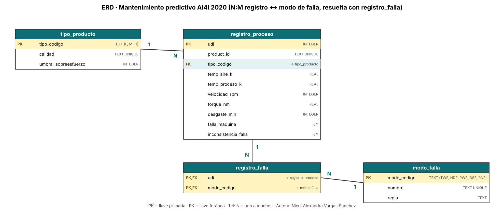

# Semana 6 · ERD de mi caso: mantenimiento predictivo (AI4I 2020)

```python
FULL_NAME   = "Nicol Alexandra Vargas Sanchez"
GITHUB_USER = "nalvargas-2024a-gif"
```

Asignatura: Ciencia de Datos · Ingeniería Industrial · Corporación Universitaria del Huila (CORHUILA) · 2026-B · Corte 2.
Guía de la actividad: *Semana 6 · ERD de tu caso* (formativa, opcional).

## 1. Caso y datos

El caso es el dataset **AI4I 2020 Predictive Maintenance** (`ai4i2020.csv`): lecturas del proceso de una máquina (temperatura del aire y del proceso, velocidad de giro, torque y desgaste de la herramienta) y si hubo falla y de qué tipo. Es un dataset **sintético** que imita datos industriales reales (así lo describe el repositorio UCI donde se publica).

Son **10 000 registros**. Cada uno trae un `UDI` (1 a 10 000), un `Product ID` único (`L47181`, `M14860`…), el tipo de producto (L, M, H), cinco lecturas, la bandera `Machine failure` (339 registros, 3,4 %) y cinco banderas de modo de falla: `TWF` (desgaste de herramienta), `HDF` (disipación de calor), `PWF` (potencia), `OSF` (sobreesfuerzo) y `RNF` (aleatoria). Los datos de partida los limpia la semana 9 (`../09-week/limpieza.py`); aquí se usa el resultado, `data/ai4i2020_clean.csv`.

## 2. ERD



La versión en Mermaid está en [`erd.md`](erd.md) y el DDL en [`schema.sql`](schema.sql).

| Entidad | PK | FK | Qué guarda |
|---|---|---|---|
| `registro_proceso` | `udi` | `tipo_codigo` | Una lectura del proceso: temperaturas, velocidad, torque, desgaste, `falla_maquina` y la marca `inconsistencia_falla` |
| `tipo_producto` | `tipo_codigo` | – | L / M / H, con su calidad y el umbral de sobreesfuerzo propio de cada tipo |
| `modo_falla` | `modo_codigo` | – | Catálogo de los 5 modos y la regla que los activa |
| `registro_falla` | (`udi`, `modo_codigo`) | ambas | **Tabla intermedia N:M**: qué modos de falla tuvo cada registro |

### Relaciones

- `tipo_producto` 1:N `registro_proceso`.
- `registro_proceso` N:M `modo_falla`, resuelta con `registro_falla`: un registro puede tener **más de un modo a la vez** (24 registros tienen 2 o 3) y un modo aparece en muchos registros. Es un N:M real: la tabla tiene 373 filas para 10 000 registros.
- `product_id` es único (`UNIQUE`), así que hoy cada producto tiene un solo registro (relación 1:1). Lo dejé como atributo de `registro_proceso` y no como tabla aparte, porque una tabla `producto` con 10 000 filas idénticas en número a los registros no aportaría nada.

## 3. ¿Relacional o NoSQL?

**Elegí el enfoque relacional (SQL).**

1. **Datos tabulares y de esquema fijo:** las 14 columnas son las mismas en las 10 000 filas.
2. **Una relación muchos-a-muchos clara** (registros ↔ modos de falla) que se consulta con `JOIN` y `GROUP BY` (Codd, 1970; Elmasri y Navathe, 2016).
3. **Integridad:** el tipo de producto y el modo de falla solo pueden ser los del catálogo (`CHECK` y llaves foráneas).
4. **Volumen pequeño** (10 000 filas): no hay un problema de escala que justifique NoSQL.

**Cuándo cambiaría:** en una planta real, los sensores generan lecturas continuas (cientos por segundo, con campos que cambian según la máquina). Esa telemetría encajaría mejor en un almacén de series de tiempo o de documentos (MongoDB, s. f.), dejando los catálogos y los eventos de falla en SQL.

## 4. Normalización

El CSV es una tabla plana: el tipo de producto y el umbral de sobreesfuerzo del tipo se repetirían en todas las filas, y los modos de falla están en 5 columnas 0/1.

| Forma normal | Qué apliqué | Redundancia evitada |
|---|---|---|
| **1FN** | Una celda, un valor; los modos de falla pasan de 5 columnas 0/1 (un «grupo repetido») a filas de `registro_falla`. | Columnas casi siempre vacías: de 50 000 celdas 0/1 solo hay 373 modos presentes. |
| **2FN** | Cada atributo depende de la llave completa: las lecturas dependen del `udi`; en `registro_falla` no hay atributos extra. | – |
| **3FN** | El `umbral_sobreesfuerzo` depende del tipo, no del registro: va en `tipo_producto` (3 filas en vez de 10 000). `delta_temp_k` y `potencia_w` se calculan a partir de otras columnas, así que **no se guardan**: viven en la vista `v_registro`. | Umbral repetido 10 000 veces; columnas derivadas que podrían desincronizarse. |

**Una dependencia que NO normalicé:** `falla_maquina` debería poder deducirse de los modos (falla si hay algún modo). Pero en **27 registros** no coincide (9 con `falla_maquina` = 1 y ningún modo; 18 con un modo y `falla_maquina` = 0). Como no sé cuál campo es el correcto, la guardo tal cual y marco esos registros en `inconsistencia_falla`. Si las banderas fueran coherentes, esa columna sobraría.

## 5. Cómo reproducirlo

```bash
python build_db.py        # crea mantenimiento.db y verifica las llaves foráneas
python dibujar_erd.py     # regenera erd.png
```

Resultado de la carga: `tipo_producto` 3 · `modo_falla` 5 · `registro_proceso` 10 000 · `registro_falla` 373, con **0 violaciones de llave foránea**.

## 6. Limitaciones

- Los datos son **sintéticos**: describen cómo se generó el dataset, no una máquina real.
- No hay fecha ni identificador de máquina, así que no se puede modelar el tiempo ni agrupar por equipo; cada `Product ID` aparece una sola vez.
- Las reglas de los modos HDF, PWF y OSF (guardadas en `modo_falla.regla`) las reproduje a partir de la descripción del dataset y las **comprobé con los datos**: coinciden en las 10 000 filas (0 discrepancias). La de TWF no es una regla exacta: los registros con TWF tienen un desgaste de 198 a 253 min, pero de los 801 registros con desgaste ≥ 200 solo 45 lo tienen.
- Las 27 incoherencias de la bandera de falla se marcan, no se corrigen.

## 7. Referencias

Chen, P. P. (1976). The entity-relationship model—Toward a unified view of data. *ACM Transactions on Database Systems, 1*(1), 9–36.

CORHUILA. (2026). *Ciencia de Datos · Semana 6 · Modelamiento de datos* [Material de clase]. Corporación Universitaria del Huila. https://code-corhuila.github.io/ova-web/2026-B/ciencia-datos/06-week/01-session/

Codd, E. F. (1970). A relational model of data for large shared data banks. *Communications of the ACM, 13*(6), 377–387.

Date, C. J. (2019). *Database design and relational theory: Normal forms and all that jazz* (2.ª ed.). Apress.

Elmasri, R., y Navathe, S. B. (2016). *Fundamentals of database systems* (7.ª ed.). Pearson.

Matzka, S. (2020). Explainable artificial intelligence for predictive maintenance applications. En *2020 Third International Conference on Artificial Intelligence for Industries (AI4I)* (pp. 69–74). IEEE.

Mermaid. (s. f.). *Entity relationship diagrams*. https://mermaid.js.org/syntax/entityRelationshipDiagram.html

MongoDB. (s. f.). *Data modeling*. https://www.mongodb.com/docs/manual/data-modeling/

SQLite. (s. f.). *SQLite foreign key support*. https://www.sqlite.org/foreignkeys.html

UCI Machine Learning Repository. (s. f.). *AI4I 2020 Predictive Maintenance Dataset*. https://archive.ics.uci.edu/dataset/601/ai4i+2020+predictive+maintenance+dataset
