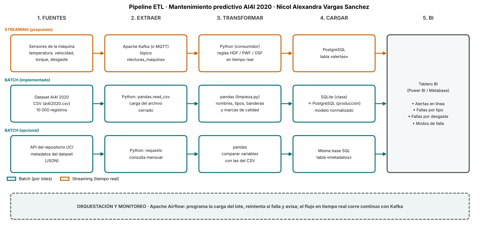

# Semana 8 · Pipeline ETL del mantenimiento predictivo (AI4I 2020)

```python
FULL_NAME   = "Nicol Alexandra Vargas Sanchez"
GITHUB_USER = "nalvargas-2024a-gif"
```

Asignatura: Ciencia de Datos · Ingeniería Industrial · CORHUILA · 2026-B · Corte 2.
Guía de la actividad: *Semana 8 · Conexión de datos: APIs, ETL y pipelines* (formativa, opcional).

## Qué se entrega

| Archivo | Contenido |
|---|---|
| [`pipeline_etl.png`](pipeline_etl.png) | Diagrama del pipeline con la herramienta de cada paso |
| [`pipeline.mmd`](pipeline.mmd) | El mismo diagrama en Mermaid (editable) |
| [`consumir_api.py`](consumir_api.py) | Consumo de una API pública con `requests`; muestra 3 registros (parte opcional) |
| [`api_sample.json`](api_sample.json) | Muestra guardada de la respuesta de la API, usada como respaldo |
| [`dibujar_pipeline.py`](dibujar_pipeline.py) | Genera la imagen del diagrama |

## 1. Pipeline: fuentes → extraer → transformar → cargar → BI



| Paso | Batch (por lotes) | Streaming (tiempo real) |
|---|---|---|
| **Fuentes** | CSV del dataset AI4I 2020; API del repositorio UCI (metadatos) | Sensores de la máquina (temperaturas, velocidad, torque, desgaste) |
| **Extraer** | `pandas.read_csv`; `requests` | Apache Kafka (o MQTT), tópico `lecturas_maquina` |
| **Transformar** | `pandas`: nombres, tipos, banderas y marcas de calidad ([`limpieza.py`](../09-week/limpieza.py)); comparar las variables del CSV con los metadatos | Consumidor en Python que aplica las reglas de falla HDF, PWF y OSF |
| **Cargar** | SQLite en clase → PostgreSQL en producción, con el modelo de la [semana 6](../06-week/README.md) | Tabla `alertas` en PostgreSQL |
| **BI** | Power BI o Metabase: fallas por tipo, fallas por desgaste, modos de falla | Panel de alertas en línea |
| **Orquestación** | Apache Airflow programa la carga, reintenta y avisa si falla | Kafka corre de forma continua |

**Qué está implementado y qué es diseño.** El flujo por lotes del CSV sí existe (semanas 6, 7 y 9, integradas en la [semana 10](../10-week/README.md)). El streaming es una **propuesta**: el dataset es un archivo estático, sin marcas de tiempo ni identificador de máquina, y no hay sensores conectados.

## 2. Batch vs. streaming: justificación

| Parte | Elección | Por qué |
|---|---|---|
| **Dataset AI4I 2020** | Batch | Es un archivo cerrado y sintético; el análisis (tasas de falla, modos) se calcula sobre el conjunto completo. |
| **Limpieza** | Batch | Validaciones como «el UDI es 1..n» o «el Product ID es único» necesitan ver el lote completo. |
| **Metadatos de la API** | Batch | Cambian muy rara vez (la respuesta dice «última actualización: 14 feb 2024»); consultarlos mensualmente sobra. |
| **Alertas de falla** | Streaming (propuesto) | Una falla por disipación de calor o por potencia se evita solo si se detecta *mientras la máquina opera*; saberlo al día siguiente solo sirve para documentarla. |

**Por qué las reglas del streaming son viables:** tres de los cinco modos de falla se comportan en estos datos como reglas exactas sobre las lecturas. Las comprobé en las 10 000 filas: **HDF** (diferencia aire-proceso < 8,6 K y velocidad < 1 380 rpm), **PWF** (potencia, torque × velocidad angular, fuera de 3 500–9 000 W) y **OSF** (desgaste × torque por encima de 11 000, 12 000 o 13 000 min·Nm según el tipo L, M o H) coinciden con la bandera en el 100 % de los registros (0 discrepancias). Un consumidor de streaming podría evaluarlas sobre cada lectura. **TWF** y **RNF** no son reglas exactas, así que no se pueden alertar de la misma forma.

**Por qué no pasar todo a streaming:** añade Kafka, más piezas que operar y más puntos de falla, sin beneficio para un dataset cerrado y para métricas que se miran por lote.

**Una advertencia sobre las reglas:** como son sintéticas, que las reglas sean exactas es una propiedad de cómo se generó el dataset. En una máquina real, esos umbrales habría que calibrarlos con su manual y con datos reales.

## 3. Consumo de una API (parte opcional)

`consumir_api.py` consulta la API pública del **UCI Machine Learning Repository** (no requiere llave) y pide los metadatos del dataset AI4I 2020 (id 601). De la respuesta toma las tres primeras variables declaradas:

```bash
python consumir_api.py
```

Salida (3 registros):

| name | role | type | units |
|---|---|---|---|
| UID | ID | Integer | – |
| Product ID | ID | Categorical | – |
| Type | Feature | Categorical | – |

El script sigue el ciclo de ETL en miniatura: `extraer()` hace la petición con `requests`, `transformar()` convierte el JSON anidado (`data` → `variables`) a tabla y el resultado se guarda en `muestra_api_3_registros.csv`.

**Un hallazgo útil:** el repositorio llama al identificador `UID`, pero el CSV lo llama `UDI`. Es una diferencia de nombre entre la documentación y el archivo; la limpieza de la semana 9 usa el del CSV (`udi`).

**Cómo se probó (para que no haya malentendidos):**

- Esos valores vienen de una consulta real a la API, hecha el 2026-10-15 con una herramienta de lectura web que **resume** la respuesta en lugar de devolver el JSON literal. En `api_sample.json` puse solo los campos que esa lectura reportó (nombre, URL, número de instancias y de características, año, última actualización y las tres primeras variables); la estructura (`status`, `statusText`, `data`) también salió de la lectura. Omití cualquier campo cuyo texto exacto no pude confirmar (como el resumen del dataset).
- Desde el entorno donde ejecuté el script **no había salida a internet** (error de proxy), así que lo que corrió fue la ruta de **respaldo**, y el script lo avisa. La ruta «en vivo» (`requests.get`) está escrita pero **no la pude ejecutar aquí**; conviene correrla una vez con conexión.

## 4. Referencias

CORHUILA. (2026). *Ciencia de Datos · Semana 8 · Conexión de datos: APIs, ETL y pipelines* [Material de clase]. Corporación Universitaria del Huila. https://code-corhuila.github.io/ova-web/2026-B/ciencia-datos/08-week/01-session/

Kimball, R., y Ross, M. (2013). *The data warehouse toolkit: The definitive guide to dimensional modeling* (3.ª ed.). Wiley.

Kleppmann, M. (2017). *Designing data-intensive applications*. O'Reilly Media.

Mermaid. (s. f.). *Flowchart syntax*. https://mermaid.js.org/syntax/flowchart.html

Reitz, K. (s. f.). *Requests: HTTP for humans* [Documentación]. https://requests.readthedocs.io/en/latest/

The Apache Software Foundation. (s. f.). *Apache Airflow documentation*. https://airflow.apache.org/docs/

The Apache Software Foundation. (s. f.). *Apache Kafka documentation*. https://kafka.apache.org/documentation/

UCI Machine Learning Repository. (s. f.). *AI4I 2020 Predictive Maintenance Dataset*. https://archive.ics.uci.edu/dataset/601/ai4i+2020+predictive+maintenance+dataset
