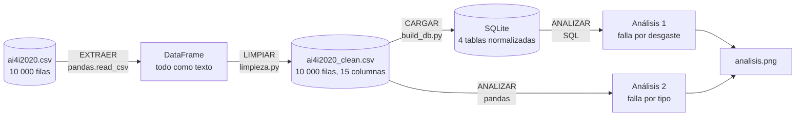

# Semana 10 · Mini-proyecto de datos (cierre del Corte 2)

```python
FULL_NAME   = "Nicol Alexandra Vargas Sanchez"
GITHUB_USER = "nalvargas-2024a-gif"
```

Asignatura: Ciencia de Datos · Ingeniería Industrial · CORHUILA · 2026-B · Corte 2.
Guía de la actividad: *Semana 10 · Repaso y evaluación del Corte 2* (formativa, opcional).

**Caso:** mantenimiento predictivo con el dataset sintético AI4I 2020 (10 000 registros del proceso de una máquina y sus fallas). Este mini-proyecto junta, en un solo flujo, lo trabajado en las semanas 6 a 9: modelo de datos, carga y limpieza con pandas, y dos análisis con consultas.

## Qué se entrega

| Archivo | Contenido |
|---|---|
| [`pipeline.py`](pipeline.py) | El flujo completo: extraer → limpiar → cargar → analizar |
| [`data/ai4i2020.csv`](data/ai4i2020.csv) | Dataset original (10 000 filas) |
| [`erd.png`](erd.png) | Modelo de datos (ERD); detalle en la [semana 6](../06-week/README.md) |
| `salidas/ai4i2020_clean.csv` | Datos limpios y listos para analizar (15 columnas) |
| `salidas/mantenimiento.db` | Los mismos datos en la base SQLite normalizada (4 tablas) |
| `salidas/analisis1_falla_por_desgaste.csv` | Resultado del análisis 1 (SQL) |
| `salidas/analisis2_falla_por_tipo.csv` | Resultado del análisis 2 (pandas) |
| `salidas/analisis.png` | Gráfica de ambos análisis |

```bash
python pipeline.py     # necesita 06-week y 09-week al lado: reutiliza su código
```

## 1. Modelo de datos (ERD)


Cuatro tablas: `registro_proceso` (el hecho), los catálogos `tipo_producto` y `modo_falla`, y la intermedia N:M `registro_falla`. La justificación relacional vs. NoSQL y la normalización están en la [semana 6](../06-week/README.md).

## 2. Flujo documentado: extraer → limpiar → analizar



| Etapa | Función | Qué hace | Resultado medido |
|---|---|---|---|
| **Extraer** | `extraer()` | Lee el CSV crudo como texto, sin interpretar nada | 10 000 filas × 14 columnas |
| **Limpiar** | `limpiar_datos()` → `limpiar()` de la semana 9 | Quita el BOM, renombra a `snake_case`, tipa, valida identificadores y rangos y marca incoherencias | Nombres fuera de `snake_case` 14 → 0 · 27 filas con falla incoherente **marcadas** |
| **Cargar** | `cargar()` | Guarda el CSV limpio y lo carga en el modelo de la semana 6; verifica llaves foráneas | 10 000 registros · 373 pares registro-modo · **0** violaciones de llave foránea |
| **Analizar** | `analizar()` | Dos consultas (filtro + agregación) y verificación cruzada SQL vs. pandas | Ver sección 3 |

**Datos listos para analizar:** `salidas/ai4i2020_clean.csv`, sin nulos ni duplicados, con nombres uniformes, tipos correctos y la marca `inconsistencia_falla`. El detalle está en la [semana 9](../09-week/README.md).

## 3. Dos análisis con consultas

Ambos excluyen las **27 filas** con la bandera de falla incoherente (quedan 9 973 registros y 330 fallas).

### Análisis 1 (SQL): ¿cómo cambia la tasa de falla con el desgaste de la herramienta?

Filtro: `WHERE inconsistencia_falla = 0`. Agregación: registros, fallas y porcentaje por tramo de 50 minutos de desgaste.

```sql
SELECT CASE WHEN desgaste_min < 50  THEN '0-49'
            WHEN desgaste_min < 100 THEN '50-99'
            WHEN desgaste_min < 150 THEN '100-149'
            WHEN desgaste_min < 200 THEN '150-199'
            ELSE '200 o más' END                       AS desgaste_tramo_min,
       COUNT(*)                                        AS registros,
       SUM(falla_maquina)                              AS fallas,
       ROUND(100.0 * SUM(falla_maquina) / COUNT(*), 1) AS pct_falla
FROM registro_proceso
WHERE inconsistencia_falla = 0
GROUP BY 1
ORDER BY MIN(desgaste_min);
```

| Desgaste (min) | Registros | Fallas | % falla |
|---|---:|---:|---:|
| 0–49 | 2 343 | 50 | 2,1 |
| 50–99 | 2 267 | 50 | 2,2 |
| 100–149 | 2 284 | 49 | 2,1 |
| 150–199 | 2 280 | 59 | 2,6 |
| 200 o más | 799 | 122 | 15,3 |

**Lectura:** la tasa de falla es plana (2,1 a 2,6 %) hasta los 200 minutos y salta a 15,3 % a partir de ahí.

**Cautelas:**

- **Es en parte circular, y conviene decirlo.** Dos de los modos de falla se definen con el desgaste: `TWF` (desgaste crítico) y `OSF` (desgaste × torque sobre un umbral). Entre los 799 registros con desgaste ≥ 200, 45 tienen `TWF` y 70 tienen `OSF`. Que la falla aumente con el desgaste es, en buena medida, la forma en que se construyó el dataset sintético, no un hallazgo sobre una máquina real.
- Es una asociación observada, no un modelo predictivo: no se entrenó ningún modelo.

### Análisis 2 (pandas): ¿cambia la falla según el tipo de producto?

Filtro: registros sin incoherencia. Agregación: tasa de falla por tipo con **intervalo de confianza del 95 %** (Wilson) y conteo por modo.

```python
for tipo, g in ok.groupby("type"):
    n, k = len(g), int(g["machine_failure"].sum())
    lo, hi = wilson(k, n)
```

| Tipo | Registros | Fallas | % falla | IC 95 % | TWF | HDF | PWF | OSF | RNF |
|---|---:|---:|---:|---|---:|---:|---:|---:|---:|
| L | 5 984 | 231 | 3,86 | 3,40 – 4,38 | 25 | 76 | 59 | 87 | 1 |
| M | 2 991 | 79 | 2,64 | 2,12 – 3,28 | 14 | 31 | 31 | 9 | 0 |
| H | 998 | 20 | 2,00 | 1,30 – 3,08 | 7 | 8 | 5 | 2 | 0 |

**Lectura:** el tipo L (calidad baja) falla más que el M y que el H; los intervalos de L y M no se solapan. Una prueba de independencia hecha aparte con `scipy` sobre los 10 000 registros da p ≈ 0,001, así que no parece ruido. El modo que más separa a L es `OSF` (87 casos frente a 9 y 2), coherente con que su umbral de sobreesfuerzo es el más bajo (11 000 frente a 12 000 y 13 000 min·Nm).

**Cautelas:**

- H solo tiene 20 fallas, por lo que su porcentaje es el más incierto (IC amplio).
- Los modos no son excluyentes (24 registros tienen más de uno), así que las columnas por modo no suman las fallas.
- Es un dataset sintético: describe el archivo, no una máquina real.

**Verificación:** el análisis 1 se recalcula en pandas dentro de `pipeline.py` y el script falla si los conteos no coinciden con los de SQL. Con estos datos coinciden.

## 4. Limitaciones generales

- Sin fecha ni identificador de máquina: no hay análisis temporal ni por equipo.
- 27 filas con banderas de falla incoherentes: excluidas de los análisis, marcadas en los datos.
- Los modos de falla son consecuencia de las lecturas (HDF, PWF y OSF son reglas exactas sobre ellas). Si más adelante se entrena un modelo, usar esas banderas como entradas sería **fuga de datos**.
- Datos sintéticos; no hay análisis causal.

## 5. Cómo se cubre la rúbrica

| Criterio | Dónde está |
|---|---|
| Modelo + carga + limpieza (50) | ERD en la sección 1; carga y limpieza en la sección 2 (`pipeline.py`) |
| 2 análisis con consultas (35) | Sección 3: uno en SQL y otro en pandas, ambos con filtro y agregación |
| Documentación del flujo (15) | Sección 2: diagrama, tabla de etapas con cifras medidas y este README |

## 6. Cómo entregarlo por GitHub

Desde la carpeta de tu fork del repositorio de la clase (`https://github.com/nalvargas-2024a-gif/electiva-vi-ciencia-datos-2026-b-g1`):

```bash
git add .
git commit -m "Entrega semana 10"
git push
```

## 7. Referencias

Chen, P. P. (1976). The entity-relationship model—Toward a unified view of data. *ACM Transactions on Database Systems, 1*(1), 9–36.

CORHUILA. (2026). *Ciencia de Datos · Semana 10 · Repaso y evaluación del Corte 2* [Material de clase]. Corporación Universitaria del Huila. https://code-corhuila.github.io/ova-web/2026-B/ciencia-datos/10-week/01-session/

McKinney, W. (2022). *Python for data analysis* (3.ª ed.). O'Reilly Media.

Python Software Foundation. (s. f.). *sqlite3 — DB-API 2.0 interface for SQLite databases*. https://docs.python.org/3/library/sqlite3.html

SQLite. (s. f.). *SQL as understood by SQLite*. https://www.sqlite.org/lang.html

UCI Machine Learning Repository. (s. f.). *AI4I 2020 Predictive Maintenance Dataset*. https://archive.ics.uci.edu/dataset/601/ai4i+2020+predictive+maintenance+dataset

Wang, R. Y., y Strong, D. M. (1996). Beyond accuracy: What data quality means to data consumers. *Journal of Management Information Systems, 12*(4), 5–33.

Wilson, E. B. (1927). Probable inference, the law of succession, and statistical inference. *Journal of the American Statistical Association, 22*(158), 209–212.
